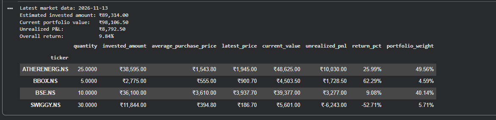
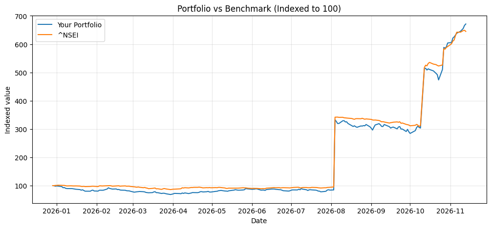
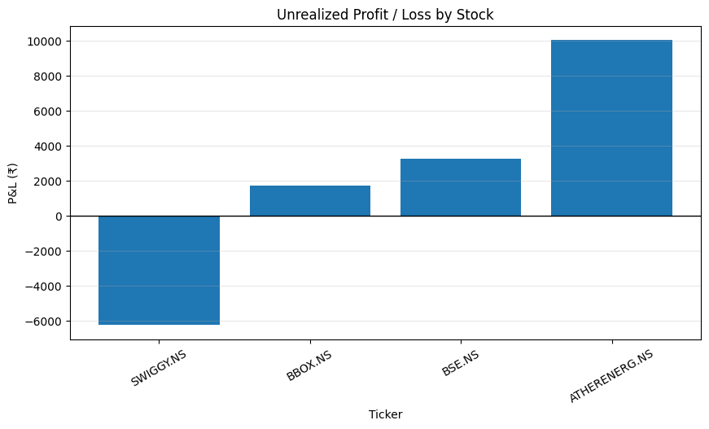
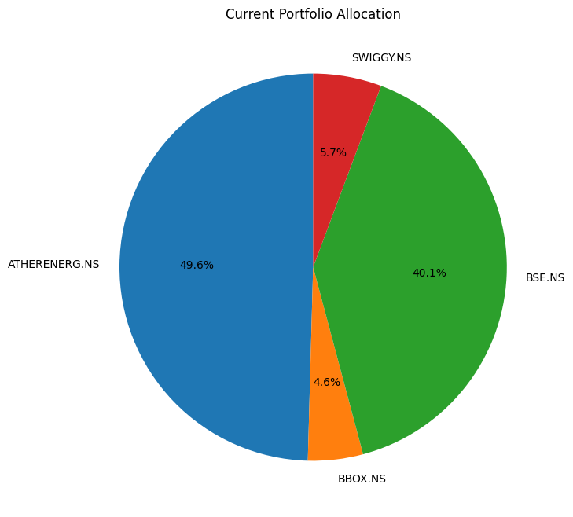
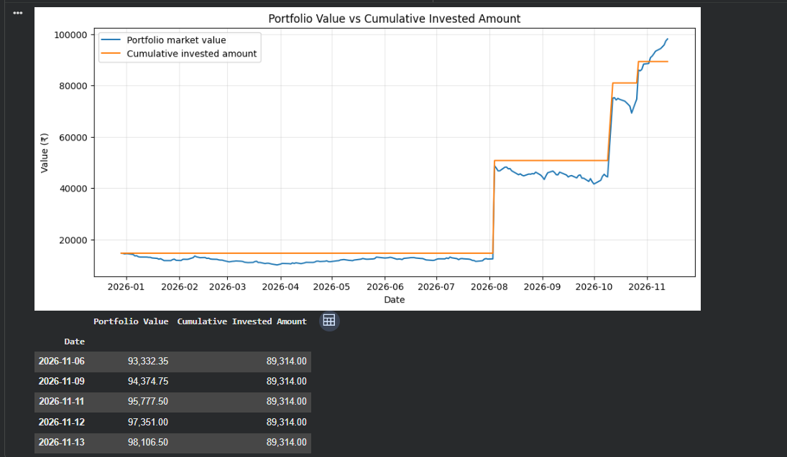
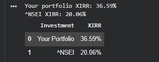

# Stock Portfolio Tracker

A Python-based stock portfolio tracker built using **Google Colab, Python, and Yahoo Finance (`yfinance`)**.

This project helps track stock investments, calculate portfolio returns, visualize performance, compare results against the NIFTY 50 benchmark, and calculate XIRR.

## Features

- Add multiple stocks to a portfolio.
- Record purchase dates, quantities, and purchase prices.
- Handle multiple purchases of the same stock.
- Calculate total investment and weighted average purchase price.
- Track current market value and unrealized profit/loss.
- Visualize portfolio allocation.
- Compare portfolio performance against the NIFTY 50.
- Calculate annualized returns using XIRR.

## Project Results

### 1. Portfolio Holdings

Displays the consolidated stock holdings, including total quantity, invested amount, average purchase price, latest market price, current value, profit/loss, and portfolio allocation.

  

### 2. Portfolio vs Benchmark

Compares portfolio performance against the NIFTY 50 (`^NSEI`).

Both are indexed to 100 to make their performance easier to compare over time.

  

### 3. Unrealized Profit / Loss

Visualizes the unrealized profit or loss generated by each stock in the portfolio.

  

### 4. Portfolio Allocation

Shows the percentage distribution of the current portfolio value across individual stocks.

  

### 5. Portfolio Value vs Cumulative Investment

Compares the historical market value of the portfolio against the cumulative amount invested.

This helps visualize how the portfolio's market value changes relative to the money invested.

  

### 6. XIRR Calculation

Calculates the annualized money-weighted return by considering the amount and timing of individual investments.

The notebook also calculates XIRR for the selected benchmark for comparison.

  

## Technologies Used

  
| Library / Tool | Purpose |
|---|---|
| Python | Core programming language |
| Google Colab | Development environment |
| yfinance | Retrieving stock market data |
| Pandas | Data manipulation and analysis |
| NumPy | Numerical calculations |
| Matplotlib | Data visualization |

  

## How to Run

1. Download or clone this repository.
2. Open the `.ipynb` notebook in Google Colab.
3. Run the notebook cells sequentially.
4. Enter your stock tickers and purchase details.
5. View the portfolio summary, charts, benchmark comparison, and XIRR results.

## Data Source

Stock market data is retrieved using Yahoo Finance through the `yfinance` Python library.

Example ticker symbols:

- `RELIANCE.NS`
- `TCS.NS`
- `INFY.NS`
- `^NSEI` (NIFTY 50 benchmark)

## Limitations

- Purchase details are entered manually.
- Market data availability and accuracy depend on Yahoo Finance.
- Brokerage, taxes, dividends, and other transaction charges may not be included.
- Historical results depend on the available price data and recorded transactions.
